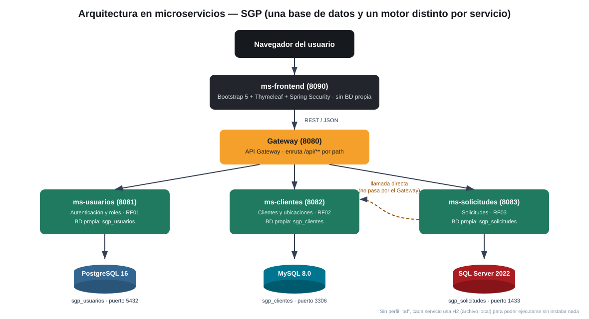

# SGP — Versión en microservicios

Este proyecto es la **misma aplicación** que `sgp-web` (el monolito MVC del Avance 1), reorganizada en servicios
independientes. Cada servicio tiene **su propia base de datos**, y todas están en un mismo motor: **PostgreSQL**.
El documento del Avance 1 sigue recomendando el monolito modular como arquitectura de producción para este
proyecto (equipo de 4 personas, 12 semanas, tamaño de SGP); esta versión existe para explorar y demostrar microservicios.
Ambas conviven en la carpeta `AvanceIntegrador`: `sgp-web` (monolito) y `sgp-microservicios` (esta).



---

## 1. Servicios y bases de datos

Todo el sistema usa **un solo motor de base de datos: PostgreSQL**. Cada microservicio tiene su propia base dentro de ese motor.

| Servicio | Puerto | Responsabilidad | Base en PostgreSQL |
|---|---|---|---|
| **ms-usuarios** | 8081 | Autenticación y roles (RF01) | `sgp_usuarios` |
| **ms-clientes** | 8082 | Clientes y ubicaciones (RF02) | `sgp_clientes` |
| **ms-solicitudes** | 8083 | Solicitudes (RF03) | `sgp_solicitudes` |
| **gateway** | 8080 | Puerta de entrada única para el Front-End | - |
| **ms-frontend** | 8090 | Portal público + panel interno (Bootstrap + Thymeleaf) | - (sin BD propia) |

Un solo motor simplifica la operación (un solo tipo de respaldo, de monitoreo y de personal). Aun así, cada servicio sigue
siendo dueño exclusivo de su base y de su usuario de base de datos.

## 2. Las dos reglas que explican el diseño

**Regla 1 — Database per service.** Cada microservicio es dueño exclusivo de su base de datos; nadie más la toca. Por eso
`Solicitud` ya no tiene un `@ManyToOne` hacia `Cliente`: guarda `clienteId` (solo un número de referencia, sin clave foránea,
porque esa tabla vive en otra base, de otro servicio) y una **copia** de `clienteNombre` y `clienteTelefono`
tomada al crear la solicitud. Es duplicación de datos para lectura: gana velocidad, y el precio es que la copia puede quedar
desactualizada si el cliente cambia de nombre.

**Regla 2 — Comunicación por REST con una sola puerta de entrada.** El Front-End nunca llama directo a los servicios: siempre
pasa por el **Gateway** (`http://localhost:8080`). Entre servicios internos (`ms-solicitudes` → `ms-clientes`) la llamada va
**directa**, sin pasar por el Gateway: el Gateway es la puerta para el exterior, no un enrutador interno.

## 3. Cómo ejecutarlo

### Ejecutar con PostgreSQL (único motor del sistema)
1. **Crear las bases:** conéctate a tu servidor PostgreSQL como `postgres` y ejecuta `docs/sql/postgres_crear_bases.sql`
   (crea los usuarios `sgp_usuarios_app`, `sgp_clientes_app`, `sgp_solicitudes_app` y las bases `sgp_usuarios`, `sgp_clientes`, `sgp_solicitudes`).
   Cambia las claves `CAMBIAR_CLAVE_...` por las de tu `.env`. El archivo `docs/sql/postgres_crear_bases.local.sql` (solo en tu PC, no se sube a GitHub) ya trae las claves del `.env`.
2. **`.env`:** copia `.env.example` a `.env` y completa `USUARIOS_DB_PASSWORD`, `CLIENTES_DB_PASSWORD`, `SOLICITUDES_DB_PASSWORD`, `SGP_API_KEY` y `SGP_JWT_SECRET` (cadenas largas y aleatorias, de 32+ caracteres)
   (las mismas claves del script), y `SGP_SEED_PASSWORD` (la contraseña de los 3 usuarios iniciales, mínimo 10 caracteres). Si tu PostgreSQL no escucha en el puerto 5432, cambia `SGP_DB_PORT` (y `SGP_DB_HOST` si no es localhost).
3. Abre `sgp-microservicios/pom.xml` en IntelliJ (como proyecto Maven) y ejecuta la configuración **`0 Todos`** de la carpeta `.run`
   (o, en orden: `1 Usuarios`, `2 Clientes`, `3 Solicitudes`, `4 Gateway`, `5 Frontend`).
4. Al arrancar, **Flyway crea las tablas** de cada base automáticamente (ver sección 4) y Hibernate comprueba que coincidan con el código.
5. Portal: http://localhost:8090 · Panel: http://localhost:8090/panel
6. Usuarios iniciales: `admin@sgp.local`, `coordinador@sgp.local`, `tecnico@sgp.local`. Los crea `ms-usuarios` la primera vez que arranca con la
   tabla de usuarios **vacía**, todos con la contraseña de `SGP_SEED_PASSWORD` (`.env`); ya no está escrita en el código. Si la tabla ya tiene usuarios,
   cambiar esa variable **no** cambia sus contraseñas: para recrearlos, vacía la tabla (`DELETE FROM usuario;` en `sgp_usuarios`) y reinicia `ms-usuarios`.
   Si falta la variable y la tabla está vacía, el servicio no arranca y lo dice en el log.

### Ejecutar con Docker (todo con un comando)

No hace falta instalar PostgreSQL ni Java: Docker levanta la base de datos y los 5 servicios. Requiere Docker Desktop.

```
docker compose up -d --build     # la primera vez tarda unos minutos (descarga imágenes y compila)
docker compose ps                # los 6 contenedores deben decir "healthy"
```

Portal: http://localhost:8090 · Panel: http://localhost:8090/panel (mismos usuarios iniciales de arriba; contraseña = `SGP_SEED_PASSWORD`).

| Comando | Qué hace |
|---|---|
| `docker compose up -d --build` | Construye y arranca todo. Úsalo también **después de editar código** (reconstruye solo lo que cambió). |
| `docker compose logs -f ms-solicitudes` | Ve el registro de un servicio (`Ctrl+C` para salir; no lo apaga). |
| `docker compose restart ms-frontend` | Reinicia un solo servicio. |
| `docker compose down` | Apaga todo. **Los datos se conservan** (volumen `sgp_pgdata`). |
| `docker compose down -v` | Apaga y **borra los datos**: la próxima vez arranca con bases vacías y los usuarios de prueba. |

**Cómo está armado.** `docker-compose.yml` define PostgreSQL (`postgres:16`) y los 5 servicios; un solo `docker/Dockerfile` compila cada uno con Maven y lo
ejecuta en una imagen mínima de Java 21, sin usuario administrador. Solo se abre al navegador el puerto **8090** (portal y panel): el Gateway y los
microservicios hablan por la red interna de Docker y **no se publican**. PostgreSQL se abre solo hacia tu PC en `127.0.0.1:5433` (para pgAdmin/DBeaver;
el 5433 evita chocar con un PostgreSQL de Windows en el 5432). La primera vez, `docker/postgres/init-bases.sh` crea las 3 bases y los 3 usuarios con las claves
del `.env` (hace lo mismo que `docs/sql/postgres_crear_bases.sql`), y Flyway crea las tablas al arrancar cada servicio.

**Claves.** Salen del mismo `.env` que usa IntelliJ; Compose se detiene y dice cuál falta. Además de las de siempre, Docker usa `POSTGRES_PASSWORD`
(administrador de PostgreSQL; ningún servicio la usa). Las claves **nunca entran dentro de las imágenes**: llegan como variables de entorno al arrancar.
Cada servicio recibe solo las suyas (ms-usuarios no ve la clave de la base de clientes). Si cambias una clave de base de datos en el `.env` **después** del primer
arranque, hay que cambiarla también en PostgreSQL (`ALTER ROLE ...`) o reiniciar de cero con `down -v`, porque el script de inicio solo corre con un volumen vacío.

**Hora de Lima.** Los contenedores usan `America/Lima`; sin eso las fechas y los «hace 5 min» del panel saldrían en UTC (5 horas de diferencia).

**IntelliJ y Docker a la vez.** Usan los mismos puertos 8090 (portal) y, si abres el Gateway, el 8080: apaga uno antes de encender el otro. Los datos son distintos: el PostgreSQL de Windows y el de Docker son bases separadas.
Para pasar datos de uno al otro: `pg_dump` de la base local y `psql` contra `127.0.0.1:5433`.

**Probar el Gateway desde tu PC** (por ejemplo `pruebas/ms_pruebas.py`): en `docker-compose.yml`, quita el `#` de las dos líneas `ports:` del servicio `gateway`.

**Límites conocidos:** `docker-compose.yml` solo es para desarrollo y demostración (HTTP, puertos de prueba abiertos). Para un servidor público usa la
configuración de producción de abajo.

### Producción: HTTPS y copias de seguridad

`docker-compose.prod.yml` se suma al compose anterior (`docker compose -f docker-compose.yml -f docker-compose.prod.yml up -d --build`) y cambia lo necesario para internet:

| Pieza | Qué hace |
|---|---|
| **Caddy** (`docker/caddy/Caddyfile`) | Única puerta pública (80 y 443). Consigue y renueva solo el certificado HTTPS (Let's Encrypt) para `SGP_DOMINIO`, redirige HTTP a HTTPS, descarta las cabeceras `X-Forwarded-*` falsas y corta envíos de más de 45 MB antes de que lleguen a Java. |
| **Puertos cerrados** | El 8090 del portal y el 5433 de PostgreSQL ya no se publican. |
| **Cookie `Secure` e IP real** | Activa `SGP_COOKIE_SECURE=true` y `SGP_FORWARD_HEADERS=native`: los límites de intentos cuentan por visitante real. |
| **`backup`** (`docker/backup/backup.sh`) | Cada noche (3:00, hora de Lima) guarda las 3 bases en `backups/` (fotos incluidas), verifica que cada archivo se pueda leer y conserva 14 días. Se marca *unhealthy* si pasan 26 h sin copia. Copia a pedido: `docker compose exec backup /bin/bash /backup.sh ahora`. |
| **Logs con rotación** | 3 archivos de 10 MB por contenedor: el disco no se llena con el tiempo. |

- **Restaurar:** `./scripts/restaurar-backup.sh backups/sgp-AAAAMMDD-HHMMSS` (pide escribir `SI`; apaga los servicios, restaura con `pg_restore` y los enciende).
- **Copias fuera del servidor:** `./scripts/subir-backups-gcs.sh <bucket>` las sube a Cloud Storage (se programa con cron). Una copia en la misma máquina no sirve si la máquina se pierde.
- **Guía completa paso a paso (Google Cloud, dominio, claves, actualizaciones, problemas comunes):** [docs/DESPLIEGUE_GCP.md](docs/DESPLIEGUE_GCP.md).
- Probado en local con un stack aparte: HTTPS y redirección, HSTS, puertos 8090/5433/8080 cerrados, cookie `Secure`, el freno de login no se esquiva falseando `X-Forwarded-For`
  a través de Caddy, corte de envíos de 46 MB (413), copia con datos reales, simulacro de pérdida de datos y restauración (los 3 usuarios vuelven y el login funciona).
  **No probado:** el certificado real de Let's Encrypt (necesita un dominio público) ni la subida al bucket (necesita una cuenta de Google Cloud).

## 4. El esquema de cada base: Flyway

Las tablas no las inventa Hibernate: las define **Flyway** con scripts SQL versionados (`src/main/resources/db/migration/`).
Las tablas de cada servicio están en `src/main/resources/db/migration/postgresql/`:

| Servicio | Script |
|---|---|
| ms-usuarios | `V1__crear_tabla_usuario.sql` |
| ms-clientes | `V1__crear_tabla_cliente.sql` |
| ms-solicitudes | `V1__crear_tabla_solicitud.sql`, `V2__datos_empresa_solicitud.sql`, `V3__tecnico_e_historial.sql`, `V4__fotos_solicitud.sql` |

Para cambiar el esquema (por ejemplo, agregar una columna) **no se edita el V1**: se agrega un `V2__descripcion.sql`
en la carpeta de cada motor. Flyway lleva el registro en la tabla `flyway_schema_history` y aplica solo lo nuevo.

Protecciones que ya van **dentro de la base de datos** (no solo en el código): teléfono `UNIQUE` en clientes (impide duplicados
aunque dos personas envíen a la vez), correo `UNIQUE` en usuarios, código `UNIQUE` en solicitudes, y `CHECK` que limita
roles, categorías, urgencias y estados a los valores válidos. Las contraseñas se guardan con BCrypt.

Cada servicio usa un **usuario propio de base de datos con permisos solo sobre su base** (lo crea el script `docs/sql/postgres_crear_bases.sql`).

## 5. Validación de datos (nombre y teléfono, entre otros)

Se valida en **cuatro capas**, porque la pantalla se puede saltar (cualquiera puede llamar al Gateway con otra herramienta):

| Capa | Qué hace | Quién decide |
|---|---|---|
| Navegador (`validacion.js` + atributos HTML) | No deja **escribir** caracteres no permitidos; limpia lo pegado | Solo ayuda al usuario |
| ms-frontend (`@Valid`) | Revisa el formulario antes de llamar al servicio | Aviso inmediato |
| Microservicio (`ms-clientes`, `ms-solicitudes`) | Revisa de nuevo cada dato | **La que realmente cuenta** |
| Base de datos | `UNIQUE`, `CHECK`, `NOT NULL`, longitudes | Última defensa |

| Campo | Regla |
|---|---|
| **Nombre** | Solo letras (con tildes y ñ), espacios, `'` `.` `-`; de 2 a 60 caracteres; **no admite números ni símbolos** |
| **Teléfono** | Solo dígitos: celular de **9 dígitos que empieza con 9**, o fijo de **7 u 8 dígitos**. Nada de letras, `+` ni espacios |
| Dirección | Letras, números, espacios y `. , # ° / -` (5 a 120 caracteres); sin `< >` |
| Distrito | Solo letras y espacios (opcional) |
| Correo | Formato `nombre@dominio.ext`, hasta 120 caracteres (opcional) |
| Descripción | 10 a 600 caracteres; sin los símbolos `< >` |

Detalles de comportamiento: al pegar «+51 987 654 321» queda `987654321`; al pegar un nombre con números se quitan los números y
se conservan las letras. Si quieres cambiar una regla, está en un solo archivo por servicio: `validation/Reglas.java`
(la regla del HTML sale de `Reglas.java` mediante `ReglasWeb`, así no hay dos reglas distintas).

## 6. Seguridad aplicada

- Contraseñas con **BCrypt**; las claves de las bases están en `.env` (fuera de GitHub) y no en el código.
- **Cabeceras de seguridad** en el Front-End: política de contenido (CSP) que solo permite scripts y estilos del propio sitio,
  `X-Frame-Options: DENY`, `X-Content-Type-Options: nosniff`, `Referrer-Policy` y `Permissions-Policy`.
- **Cookie de sesión** con `HttpOnly` y `SameSite=Lax`; protección CSRF en todos los formularios.
- Páginas de error propias (403, 404, 503): no se muestran trazas ni mensajes técnicos.
- Tiempos máximos de espera entre servicios, para que una caída no deje la pantalla cargando para siempre.
- Escape de todo texto en las pantallas (Thymeleaf) y rechazo de `< >` en los campos de texto.
- Un usuario de base de datos por servicio, con permisos solo sobre su base.

- **Clave compartida de la API (`SGP_API_KEY`).** El Front-End manda la cabecera `X-SGP-Api-Key` en toda llamada al Gateway;
  el **Gateway** y cada **microservicio** (`ms-usuarios`, `ms-clientes`, `ms-solicitudes`) rechazan con **403** toda petición `/api/**`
  que no la traiga o la traiga distinta. La comparación es en tiempo constante. Si la clave no está en `.env`, el servicio
  **rechaza todo** (falla cerrado) y avisa en el log. Así, ni el Gateway (8080) ni los puertos internos (8081, 8082, 8083) responden
  a quien no tenga la clave. `ms-solicitudes` también la envía en su llamada directa a `ms-clientes`.
  Para activarla: agrega `SGP_API_KEY=<cadena larga y aleatoria>` al `.env` (la misma para todos) y reinicia los 5 servicios.
  Las consultas DNI/RUC conservan además su clave propia (`SGP_DNI_INTERNAL_KEY`).

- **JWT con roles en la API (`SGP_JWT_SECRET`).** Al iniciar sesión, `ms-usuarios` valida la contraseña y **firma un JWT** (HS256, 8 h)
  con el correo y el rol. El Front-End lo guarda **solo en la sesión del servidor** (nunca llega al navegador ni a las cookies) y lo
  manda en `Authorization: Bearer ...` en cada llamada al Gateway. El **Gateway verifica la firma** (no firma nada) y decide por rol,
  con una tabla en `gateway/.../JwtFilter.java`:

  | Ruta | Quién |
  |---|---|
  | `POST /api/usuarios/login`, `POST /api/solicitudes` y `POST /api/solicitudes/{id}/fotos` (formulario del portal), `POST /api/clientes/dni` y `/ruc` | Pública (solo exige la clave compartida) |
  | `GET /api/solicitudes`, `/recientes`, `/resumen`, `/cola`, `/pulso`, `/{id}`, `/{id}/historial`, `/{id}/fotos` y `/{id}/fotos/{fotoId}` | Cualquier usuario con sesión |
  | `PUT /api/solicitudes/{id}/estado`, `PUT /api/solicitudes/{id}/tecnico`, `GET /api/usuarios/tecnicos`, `GET/POST /api/clientes`, `GET /api/clientes/buscar` | Administrador y Coordinador |
  | Cualquier otra ruta | Solo Administrador (se niega por defecto) |

  Sin token, o con token falso, alterado o vencido → **401**; token válido pero rol insuficiente → **403**. Un Técnico no puede
  hacerse Administrador editando su token: no conoce el secreto y la firma dejaría de coincidir. Si el token vence, el Front-End
  cierra la sesión y lleva al login con el aviso «Tu sesión venció». El Gateway también borra las cabeceras `X-SGP-Usuario` y
  `X-SGP-Rol` que lleguen de afuera y pone las verificadas. Para activarlo agrega `SGP_JWT_SECRET=<32+ caracteres aleatorios>` al `.env`:
  sin él, `ms-usuarios` **no arranca** y el Gateway rechaza lo que exige sesión.

- **Contraseñas iniciales fuera del código (`SGP_SEED_PASSWORD`).** Los 3 usuarios iniciales toman su contraseña del `.env` (mínimo 10 caracteres); no hay
  ninguna escrita en el repositorio. El `.gitignore` excluye `.env` y también cualquier copia (`.env.*`), salvo `.env.example`.

- **Freno a las contraseñas adivinadas (login).** Tras 10 contraseñas erróneas desde una misma IP, o 15 contra un mismo correo desde cualquier IP, en 10 minutos,
  `/login` deja de aceptar intentos y muestra «Demasiados intentos fallidos» hasta que pase la ventana. Un login correcto limpia el contador de ese correo (no el de la IP).
  Compromiso: alguien puede bloquear un correo ajeno durante unos minutos fallando 15 veces a propósito; es el precio de frenar ataques repartidos entre muchas IP.
- **Freno al abuso del formulario público.** Por IP: 8 envíos en 10 minutos y 30 al día (cada envío puede traer hasta 24 MB de fotos guardadas en la base),
  y 20 consultas DNI/RUC en 10 minutos (cada una gasta cupo del proveedor). El filtro va **antes** del CSRF, así un envío rechazado no llega a cargar sus fotos.
  Los topes se cambian en `sgp.limites` (`ms-frontend/application.yml`) o con variables de entorno (p. ej. `SGP_LIMITES_ENVIOS_POR_IP=100`).
  Los contadores viven en memoria: se reinician al reiniciar el servicio.
- **Cookie `Secure` y proxy HTTPS.** `SGP_COOKIE_SECURE=true` marca la cookie de sesión como `Secure` (el navegador no la manda sin HTTPS); déjala en `false`
  con `http://localhost`, o el login no guardaría la sesión. `SGP_FORWARD_HEADERS=native` hace que Tomcat tome la IP y el `https` reales de `X-Forwarded-*`, **solo**
  cuando vienen de un proxy de red privada (Caddy/nginx en Docker). Es lo que hace que los frenos de arriba cuenten por visitante y no por el proxy. Con el valor
  por defecto (`none`) esas cabeceras se ignoran, y por eso **un visitante no puede falsear su IP**. Con HTTPS activo, Spring Security envía además `Strict-Transport-Security`.
  Importante: sin proxy, todos los visitantes que lleguen por el mismo camino comparten IP (por ejemplo, el puerto 8090 de Docker en Windows), y los frenos
  cuentan a todos juntos; para una demostración con muchas pruebas seguidas sube los topes.

**Pendientes (por honestidad):**
1. **Los microservicios (8081-8083) confían en el Gateway para los roles:** validan la clave compartida, pero no el JWT. Quien tenga la clave
   y llame directo a un puerto interno se salta los roles. Mitigación: no exponer esos puertos; mejora: que cada servicio verifique también el JWT.
2. **El token no se puede revocar** antes de que venza (por ejemplo, al desactivar un usuario o cambiar su rol): sigue valiendo hasta las 8 h.
   Mejora: vigencia corta con renovación, o una lista de tokens revocados.
3. **HTTPS** (RNF01) lo da `docker-compose.prod.yml` con Caddy (ver «Producción»). En desarrollo (`docker-compose.yml`, IntelliJ) sigue siendo HTTP: la clave y el token viajan en claro por la red local.
4. **Sin CAPTCHA** en el formulario público: los límites por IP frenan el abuso casual, pero no a quien use muchas IP distintas.
5. Los frenos cuentan **en memoria de un solo servidor**: no se comparten si hay varias copias de `ms-frontend`.

## 7. Qué se probó (y qué no)

Se ejecutó una batería de **51 pruebas reales** (carpeta `pruebas/`): **51 aprobadas, 0 rechazadas**. Incluye: 22 intentos de
datos inválidos contra la API saltándose el formulario (nombres con números, teléfonos con letras, HTML, SQL, etc.),
10 solicitudes simultáneas con el mismo teléfono (se crea un solo cliente), formularios, login, cabeceras y cookie de
seguridad, y los atributos HTML de los campos. También se comprobó con el servicio de clientes apagado: el usuario ve un aviso claro y el
resto del sistema sigue funcionando.

| Pieza | Estado |
|---|---|
| Pieza | Estado |
|---|---|
| 3 servicios con **PostgreSQL** | **Pendiente de probar** tras el cambio de motor: ms-usuarios ya se había probado con PostgreSQL; ms-clientes y ms-solicitudes tienen migraciones nuevas para PostgreSQL |
| Lectura de claves desde `.env` | **Probado** (el servicio se conectó a PostgreSQL leyéndolas del archivo) |
| Configuraciones de la carpeta `.run` de IntelliJ | **Pendiente de probar** tras el cambio de nombres |

## 8. Interfaz con Bootstrap

### Consulta DNI en el formulario público

El campo opcional DNI y el botón «Consultar DNI» completan el nombre con nombres y apellidos
devueltos por Decolecta. La consulta pasa por Front-End, Gateway y ms-clientes; el token nunca
se envía al navegador. Se usa el contrato documentado en
https://decolecta.gitbook.io/docs/servicios/integrations-2.

Configura `DECOLECTA_TOKEN` y una clave aleatoria `SGP_DNI_INTERNAL_KEY` en `.env` en la raíz
del proyecto; Front-End y ms-clientes deben cargar el mismo archivo. Reinicia ambos servicios
después de cambiar estas variables y mantén Gateway iniciado. La clave interna protege este
nuevo endpoint, sin modificar la seguridad de los otros endpoints existentes.

Se valida el DNI de 8 dígitos, se conserva CSRF y se limitan las consultas a una cada 5 segundos
por sesión y 30 por minuto por instancia de ms-clientes. Los límites son en memoria y se
reinician con la aplicación. Los errores no muestran respuestas internas del proveedor.
Si no hay resultados, saldo, conexión o configuración, se permite escribir el nombre manualmente.
El DNI se usa para autocompletar: no se almacena ni acredita que el solicitante sea su titular.
Se conserva el campo `nombre` y el esquema actual de las bases; no requiere migración.

El Front-End usa **Bootstrap 5.3** (navbar, carrusel, tarjetas, formularios con validación, tablas, menú lateral que se
convierte en panel desplegable en el celular) con el **tema de SGP** encima: negro grafito y ámbar, estilo constructora
(`static/css/site.css`). Bootstrap y sus íconos se sirven desde el propio proyecto (WebJars), no desde un CDN: funciona sin
internet y es compatible con la política de seguridad CSP.

## 9. Estructura de carpetas

```
sgp-microservicios/
├── pom.xml                      (agregador de los 5 módulos)
├── .env / .env.example          (claves de las bases y ruta de BaseDB_InteII; .env no se sube a GitHub)
├── .run/                        (configuraciones de ejecución para IntelliJ)
├── docker-compose.yml           (PostgreSQL + los 5 servicios con un solo comando)
├── docker/                      (Dockerfile compartido y postgres/init-bases.sh, que crea las 3 bases)
├── docs/                        (arquitectura.svg y docs/sql/ con los scripts de creación de cada base)
├── pruebas/                     (scripts y resultados de las 51 pruebas)
├── ms-usuarios/   src/main/{java/pe/sgp/usuarios, resources/{application.yml, db/migration/postgresql}}
├── ms-clientes/   src/main/{java/pe/sgp/clientes, resources/{application.yml, db/migration/postgresql}}
├── ms-solicitudes/src/main/{java/pe/sgp/solicitudes, resources/{application.yml, db/migration/postgresql}}
├── gateway/       src/main/{java/pe/sgp/gateway, resources/application.yml}
└── ms-frontend/   src/main/{java/pe/sgp/frontend, resources/{templates, static/{css,js,img}}}
```

## 10. Cómo explicarlo en 90 segundos frente al profesor

> "Dividí el sistema en tres microservicios según el negocio -usuarios, clientes y solicitudes- más un Front-End que no
> guarda datos. Cada servicio tiene su propia base de datos (database per service) y todas viven en un mismo motor:
> PostgreSQL. Nadie hace JOIN entre bases:
> cuando solicitudes necesita un cliente se lo pide a clientes por REST, y guarda una copia del nombre. Las tablas las crea
> Flyway con scripts versionados, y las claves viven fuera del código. Los datos se validan en cuatro capas —navegador,
> Front-End, microservicio y base de datos— porque la pantalla se puede saltar; el nombre no admite números y el teléfono
> solo admite dígitos. El Front-End solo conoce al Gateway, que es la única puerta de entrada. Si un servicio se cae, el
> usuario ve un aviso claro y el resto sigue funcionando."

## Flujo de la solicitud, técnico asignado e historial

**Etapas y pasos permitidos.** El flujo vive en un solo lugar, `EstadoSolicitud.siguientes()` (ms-solicitudes); la API lo entrega en cada
solicitud (`siguientes`) y la pantalla solo ofrece esas opciones. El servicio lo vuelve a comprobar (la pantalla se puede saltar) y responde
**409** con un mensaje claro si el paso no es válido.

| Desde | Puede pasar a |
|---|---|
| Registrada | Pendiente de evaluación, Cerrada |
| Pendiente de evaluación | Cotizada, Cerrada |
| Cotizada | Aprobada, Pendiente de evaluación (re-evaluar), Cerrada |
| Aprobada | Programada, Cerrada |
| Programada | En ejecución, Aprobada (reprogramar), Cerrada |
| En ejecución | Cerrada, Programada (reprogramar) |
| Cerrada | — (es final: no se reabre) |

Pedir la etapa en la que ya está no hace nada ni duplica el historial. **Programar o iniciar la ejecución exige un técnico asignado.**

**Técnico asignado.** Solo Administrador y Coordinador asignan. ms-solicitudes comprueba con ms-usuarios (`GET /api/usuarios/tecnicos`, solo
técnicos activos) que el correo sea de un técnico de verdad, y guarda una **copia** de su nombre y correo (mismo criterio que el cliente: sin clave
foránea entre bases). No se puede quitar al técnico de una solicitud programada o en ejecución, ni cambiarlo en una cerrada.

**Historial.** Tabla `solicitud_historial` (con clave foránea real, porque está en la misma base): cada creación, cambio de etapa y cambio de
técnico guarda quién (el correo del JWT que verificó el Gateway, enviado en `X-SGP-Usuario`), cuándo y qué cambió. Solo se agregan líneas; los intentos
rechazados no dejan rastro. La migración V3 conserva las solicitudes existentes y les crea su línea «Solicitud registrada» con la fecha original.
En el panel: clic en el código de una solicitud abre su ficha con técnico, cambio de etapa e historial.

**Nuevas rutas del Gateway:** `GET /api/solicitudes/{id}` y `/{id}/historial` (cualquier usuario con sesión), `PUT /api/solicitudes/{id}/tecnico` y
`GET /api/usuarios/tecnicos` (Administrador y Coordinador).

**Límites conocidos:** quien figura en el historial depende de que el Gateway ponga `X-SGP-Usuario`; una llamada directa a ms-solicitudes con la clave
compartida (sin pasar por el Gateway) quedaría como «desconocido». El Técnico aún ve todas las solicitudes, no solo las suyas.

## Fotos de evidencia, cola de atención y alertas

**Fotos de evidencia.** En el formulario público el cliente puede adjuntar hasta **4 fotos** (JPG, PNG o WebP, hasta **6 MB** cada una). El navegador
(`fotos.js`) las reduce a 1600 px antes de enviarlas. El Front-End las reenvía al Gateway justo después de registrar la solicitud
(`POST /api/solicitudes/{id}/fotos`); si fallan, la solicitud **no se pierde** y se avisa al cliente. ms-solicitudes las guarda en su base
(tabla `solicitud_foto`, migración **V4**) y las valida por su **contenido** (los primeros bytes del archivo), no por el nombre ni el `Content-Type`:
un `.exe` renombrado a `.jpg` se rechaza. El nombre se limpia (sin carpetas ni caracteres raros). Solo se aceptan fotos mientras la solicitud es
reciente (15 minutos) y sigue en «Registrada». En el panel se ven en la ficha de la solicitud (clic en el código), con visor ampliado, y la lista muestra
cuántas fotos tiene cada una. Las fotos **solo las ve quien entró al panel**: el navegador las pide al Front-End (`FotoController`), que las trae
del Gateway con el JWT del usuario.

**Cola y orden de atención.** Las solicitudes se listan en **orden de atención**: primero las abiertas, luego la prioridad más alta (Alta, Media, Baja),
luego la que llegó antes. Las cerradas van al final. El tablero muestra la cola (la primera es la que toca atender ahora) y la lista muestra cuánto lleva
esperando cada solicitud.

**Alertas de solicitudes nuevas.** El panel consulta cada 15 segundos `GET /panel/alertas` (que llama a `/api/solicitudes/pulso`) y avisa cuando llega una
solicitud, con su prioridad. El menú muestra el contador de solicitudes «sin revisar» (las que siguen en «Registrada»). Los avisos se dibujan con
`textContent`, nunca con HTML, así que un nombre malicioso no puede inyectar código.

**Qué se unificó.** Este proyecto reúne dos líneas de trabajo: la de seguridad y flujo (clave API, JWT, estados, técnico, historial) y la de evidencia
(fotos, cola, alertas). Como ambas tenían una migración `V3` distinta, la de fotos pasó a **V4** (la V3 de técnico e historial ya estaba aplicada en la base).
Cambios al integrar: la descarga de fotos va en su propia clase para que cada imagen no dispare además la consulta del contador; se quitó el
«diagnóstico temporal» que escribía errores completos (con posibles datos de clientes) en un archivo temporal, y ahora el detalle queda solo en el registro
del servidor; y el límite de tamaño del contenedor del Front-End (10 MB) quedó por encima de la regla de 6 MB para que el aviso amable lo dé el controlador
y no un 403 del filtro CSRF.

**Límites conocidos:** el formulario público no tiene límite de envíos ni CAPTCHA, y cada solicitud puede guardar hasta 24 MB de fotos en la base:
conviene un límite por IP antes de abrirlo a internet. Un envío de más de 10 MB por foto (solo posible sin el navegador) responde 403.

## Solicitudes de empresa y consulta RUC

El formulario público permite elegir **Persona natural** (DNI opcional) o **Empresa**.
Para empresas son obligatorios el RUC de 11 dígitos, razón social, persona de contacto,
teléfono y correo, además de los datos del servicio. Dirección fiscal y cargo son opcionales.
La razón social admite números y signos de uso empresarial; no usa el filtro de nombres personales.

«Consultar RUC» llama al frontend por POST con CSRF, luego al Gateway y a ms-clientes.
RucClient consulta https://api.decolecta.com/v1/sunat/ruc con el DECOLECTA_TOKEN
ya configurado en .env. Reutiliza SGP_DNI_INTERNAL_KEY para proteger el endpoint interno.
El token necesita acceso/saldo para RUC en Decolecta; el acceso a DNI no garantiza ese permiso.
Documentación del contrato: https://decolecta.gitbook.io/docs/servicios/integrations.
Las consultas están limitadas a una cada 5 segundos por sesión y 30 por minuto por instancia
de ms-clientes. Los errores permiten continuar con ingreso manual; consultar no registra datos.

Al enviar, ms-solicitudes guarda una copia de la razón social, RUC, dirección fiscal, cargo,
persona/correo de contacto y necesidad de factura en la solicitud. ms-clientes mantiene
el contacto asociado por teléfono; no se crea un catálogo maestro de empresas en esta versión.
El panel de solicitudes muestra la razón social y un desplegable «Datos de empresa».
La dirección del servicio es independiente de la dirección fiscal y no se sobrescribe.

Flyway aplica V2__datos_empresa_solicitud.sql al reiniciar ms-solicitudes (carpeta `postgresql/`).
V2 añade columnas y conserva las solicitudes previas como PERSONA.
Como en cualquier actualización de esquema, conservar una copia de seguridad antes de aplicarla sobre datos importantes.

«Requiere factura electrónica» registra una preferencia; no emite ni envía comprobantes.
La consulta RUC autocompleta datos y no acredita la identidad del representante.

Después de actualizar, recompilar y reiniciar ms-clientes, ms-solicitudes y ms-frontend,
manteniendo Gateway activo. No se necesita cambiar el token ni migrar ms-usuarios/ms-clientes.

Pruebas: mvn -pl ms-clientes,ms-solicitudes,ms-frontend test, además de
node --test pruebas/dni_frontend.test.cjs. Se prueban respuestas del proveedor simuladas,
validación de empresas, envío del formulario, CSRF, persistencia y migración (con H2 solo en las pruebas) desde V1
con registros previos. La migración de PostgreSQL se aplica con Flyway al arrancar ms-solicitudes.
